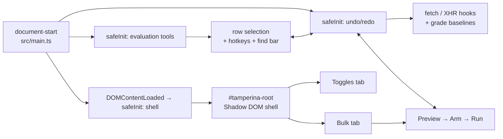

#  Tamperina — Documentation

Tamperina is a single-file Tampermonkey userscript that adds a pixel-mascot launcher, a settings modal, and a set of workflow tools to the Ahmed Zakaria platform. This directory describes the script **as it exists today** (version **0.0.24**).

 

  

 

## Contents

| Document | Audience | Read this to… |
|---|---|---|
| [User Guide](user-guide.md) | Platform operators, admins, anyone installing the script | Install, drive the mascot, understand every toggle, and run each workflow safely |
| [Feature Reference](feature-reference.md) | Everyone | Look up an exact shortcut, toggle default, input format, menu command, or toast variant |
| [Architecture](architecture.md) | Developers & advanced users | Understand boot order, Shadow DOM, network observers, storage, the remote bridge, and the design system |
| [Developer Guide](developer-guide.md) | Contributors | Build both userscripts, run the test gate, work with CI, and add features, strings, or images |
| [API Reference](api-reference.md) | Contributors | Exact exports, types, storage keys, endpoints, selectors and protocol contracts |
| [Troubleshooting](troubleshooting.md) | Everyone | Diagnose a missed undo, a short bulk run, a stuck remote command, or a broken page integration |

Release history lives in [`../CHANGELOG.md`](../CHANGELOG.md). The user-facing overview lives in [`../README.md`](../README.md).

---

## At a glance

- **One file, no runtime deps** — `dist/tamperina.user.js` contains the TypeScript build, the Cairo font and every mascot image as data URLs.
- **Arabic-first, bilingual** — UI defaults to Arabic to match the host platform; an English mode switch flips Tamperina-owned labels and the layout to LTR. Host-page data (grade keys, status words, selectors, examples) stays Arabic in both modes.
- **Isolated UI** — everything renders inside `#tamperina-root` with an open Shadow Root, so host-page CSS cannot style it and its events do not leak back.
- **Early observers** — `initUndoRedo()` and `initEvaluationTools()` run at `document-start`, before the platform issues requests or installs its own handlers. Each subsystem is wrapped so one failure cannot kill the others.
- **Undo/redo for real writes** — attendance adds/removes and confirmed grade writes are replayed through the platform's own endpoints; bulk runs are committed as a single batch. History lives in `sessionStorage`.
- **Bulk with a safety path** — Preview → resolve → Arm → Run → per-row log → one undoable batch (where a confirmed undo route exists).
- **Four run kinds** — `attendance`, `evaluation`, `exam-attendance`, `exam-evaluation`, selectable locally or from another tab through the remote bridge.
- **Persistence split by concern** — `GM_setValue` for shell/toggles/bridge state, `localStorage` for small evaluation flags, `sessionStorage` for undo history and the last attendance report.
- **Trust boundaries are explicit** — persisted state, bridge messages and host-page text are all validated/escaped before use; replay headers are allow-listed and no cookies or tokens are stored.

### Execution model

Full detail: [Architecture](architecture.md).

---

## Canonical sources of truth

| Concern | Source |
|---|---|
| Version | `package.json` → injected into both `@version` headers by `vite.config.ts` |
| Userscript metadata, builds, asset inlining | `vite.config.ts` |
| Shell state schema & defaults | `src/core/storage.ts` |
| Toggle cards and bulk UI behavior | `src/core/ui.ts` |
| Undo history & replay contracts | `src/core/undoRedo.ts` |
| Parsers | `src/core/bulkAttendance.ts`, `src/core/bulkEvaluation.ts` |
| Page/guard rules | `src/core/pageGuards.ts`, `src/core/examGuards.ts` |
| UI strings | `src/core/i18n/` (4 catalogs, 549 keys at this baseline) |
| Visual design tokens | `src/ui/styles.css` |
| Tests | `tests/` (`vitest` + `happy-dom`) |
| Release notes | `CHANGELOG.md` |

>  **Version notes:** when you bump `package.json`, rebuild `dist/` and add a `CHANGELOG.md` entry. CI auto-bumps the patch version only when the generated script changed and the version did not.

---

## Glossary

| Term | Meaning in Tamperina |
|---|---|
| **Shell** | The launcher + modal + toasts + find bar mounted inside `#tamperina-root`. |
| **Rina** | The pixel mascot. Images in `public/rina/` are inlined at build time; the basename is the image key. |
| **Toggle / feature** | An independent switch in **المفاتيح**. Most are persisted; some are page-gated. |
| **Run kind** | One of the four bulk operations that can be executed locally or remotely. |
| **Arming** | The explicit second confirmation after preview, required before a bulk write can run. |
| **Batch** | One undoable history entry containing all successful actions of a bulk run. |
| **Bridge** | The `GM_setValue` protocol in `tamperina.remoteBulk.v1` used to command another tab. |
| **Baseline** | A captured value (grade fields, live attendance records) used to build an inverse action. |
| **Observer event** | An `add` / `duplicate` / `remove` signal derived from a network response, used to confirm writes. |
| **Host page** | The Ahmed Zakaria platform page Tamperina runs on. |

---

## Image assets used by these docs

Documentation images are referenced from source paths so GitHub can render them without a build step. The docs reuse the stickers already in `public/rina/`; see the [image asset map in the developer guide](developer-guide.md#image-assets) for the current artwork and app mappings.

 

  Docs maintained for v0.0.24 — One Mascot, Four Tool Families.

