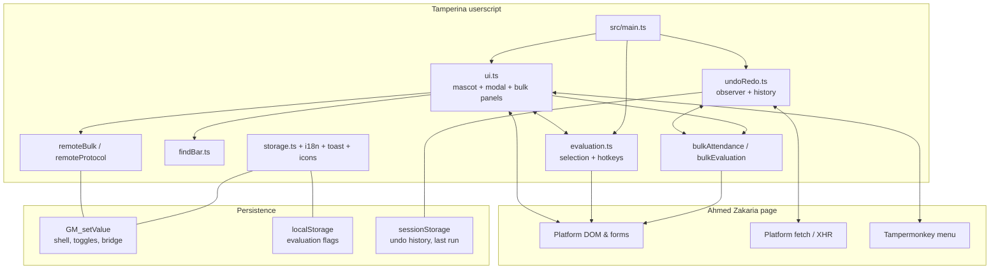
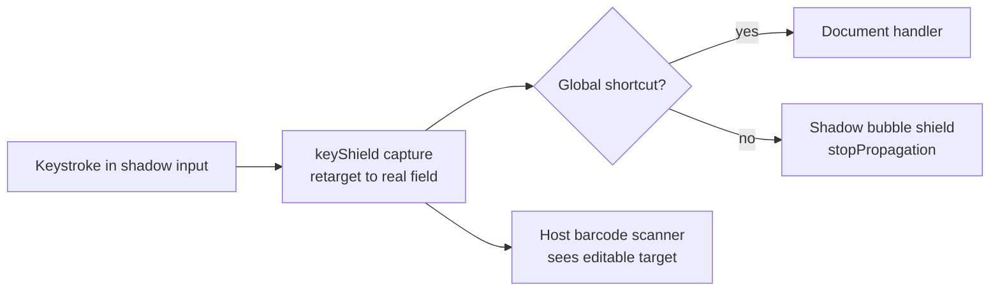
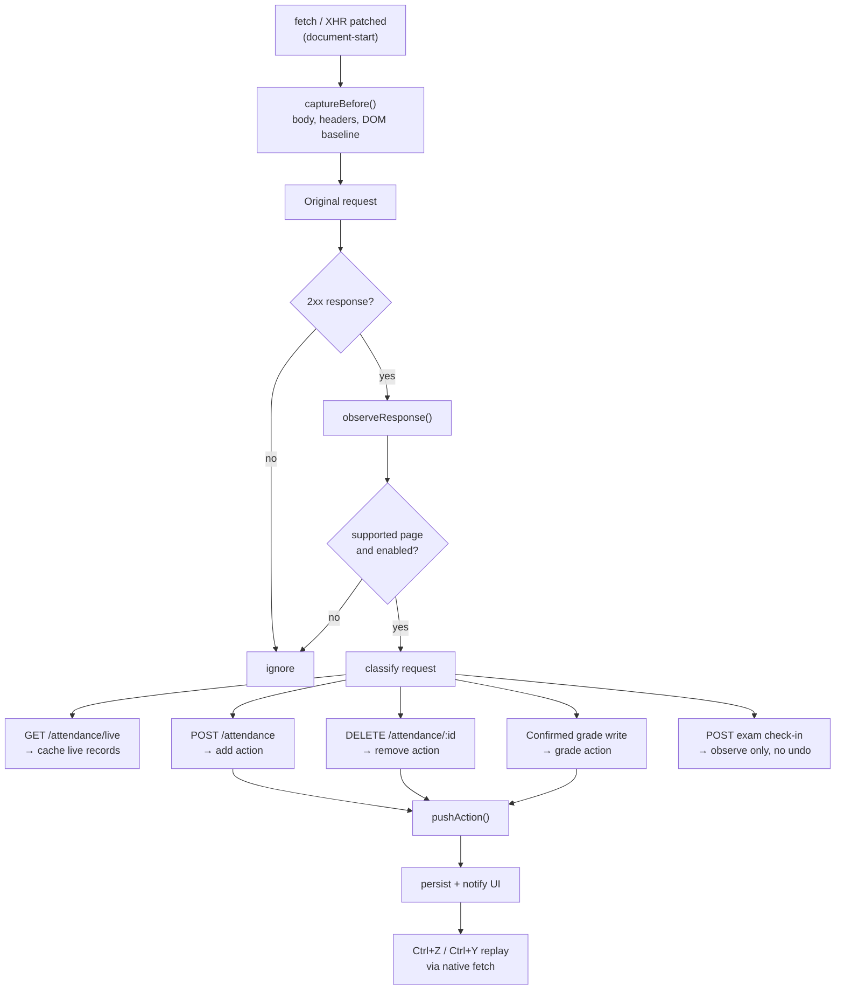
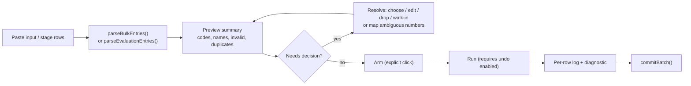
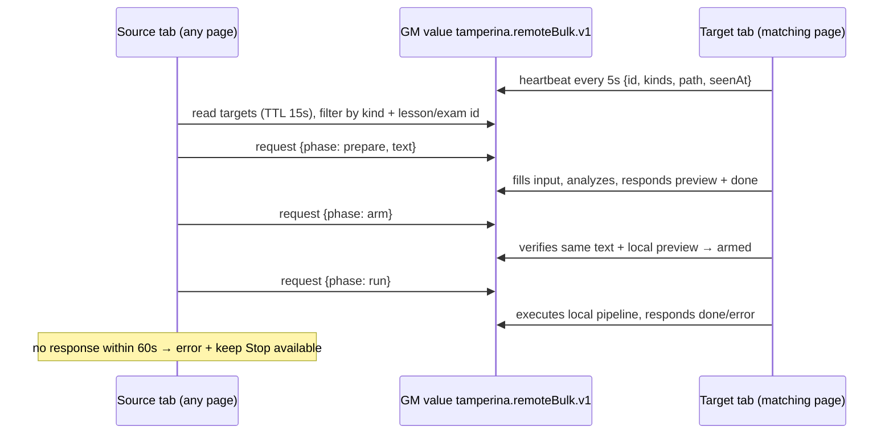

#  Architecture

This document explains how Tamperina is put together: what happens at `document-start`, where state lives, how writes are observed and replayed, how the remote bridge works, and what the UI is made of. The [API Reference](api-reference.md) has the exact signatures and constants.

---

## 1. Big picture

Tamperina is one Vite-built userscript with **no runtime npm dependencies**. TypeScript, the Cairo variable font, and every mascot image are compiled into a single `.user.js`. At runtime it coexists with the host page rather than taking it over:

- It never removes or replaces host-page controls; it fills them in and dispatches the same events a person would.
- Its UI lives in an **open Shadow Root** at `#tamperina-root`.
- It installs observers **at document-start** so the platform's own requests can be seen before they complete.
- A small set of persistence stores (GM values, localStorage, sessionStorage) keeps state without a backend.



---

## 2. Boot sequence

`src/main.ts` is intentionally tiny:

```ts
safeInit('undo/redo', initUndoRedo)
safeInit('evaluation tools', initEvaluationTools)

if (document.readyState === 'loading') {
  document.addEventListener('DOMContentLoaded', start, { once: true })
} else {
  start()
}
function start(): void { safeInit('shell', mountShell) }
```

- **Why document-start for observers?** `initUndoRedo()` patches `fetch` and `XMLHttpRequest` before the platform can issue its first requests or install its own handlers. Grade baselines are captured before programmatic writes.
- **Why `safeInit`?** Each subsystem is wrapped so a failure is logged as `[Tamperina] <label> failed to initialize` and cannot prevent the other subsystems from starting.
- **Why wait for the shell?** The modal needs a live DOM to mount into; observers only need `window`.

`mountShell()` itself is idempotent: if `#tamperina-root` already exists, it returns. It registers the Cairo faces, injects page-level toggle styles, creates the host and shadow root, attaches the toaster and find bar, builds the launcher/modal markup, applies translations, installs event shields, wires handlers and page panels, registers menu commands, applies any WhatsApp hold, then renders.

---

## 3. Module map

| Module | Responsibility |
|---|---|
| `src/main.ts` | Boot + error isolation. |
| `src/ui/styles.css` | Shadow-DOM design system, mascot animation, modal, toasts, find bar, LTR overrides, reduced motion. |
| `src/core/storage.ts` | `ShellState` schema, defaults, strict validation, `loadShell()` / `saveShell()`. |
| `src/core/ui.ts` | Mascot interactions, tabs, toggle cards, bulk panels, shortcuts, menu commands, WhatsApp hold, page panels, last-run storage. |
| `src/core/i18n.ts` + `src/core/i18n/*` | Locale state, `t()`, interpolation, declarative `data-i18n*` translation, four catalogs. |
| `src/core/toast.ts` | Toast implementation attached to the shadow root; safe no-op before mount. |
| `src/core/undoRedo.ts` | Request hooks, snapshots, history, replay, batching, diagnostics. Shared between prod and DEV via `unsafeWindow`. |
| `src/core/evaluation.ts` | Row selection, grade hotkeys, exam-score typing, homework-button detection/diagnostics. |
| `src/core/findBar.ts` | Search bar, match navigation, 4-digit auto-select, CSS Custom Highlights. |
| `src/core/bulkAttendance.ts` | Attendance parser, name resolution, school/center/exam run engines, walk-in support, diagnostic report. |
| `src/core/bulkEvaluation.ts` | Evaluation line parser, page-candidate matching, grade application. |
| `src/core/pageGuards.ts` | Run kinds, local page paths, remote target and input validation. |
| `src/core/examGuards.ts` | Exam id extraction, comprehensive-exam paths, exam input validation. |
| `src/core/remoteBulk.ts` | Cross-tab bridge, heartbeat, request lifecycle. |
| `src/core/remoteProtocol.ts` | Validation of untrusted bridge state. |
| `src/icons.ts` | Inline Lucide SVG strings. |
| `src/ui/dom.ts` | `escapeHtml()` for host-page text in generated markup. |
| `src/ui/keyShield.ts` | Shadow-DOM keyboard retargeting. |
| `src/ui/pagePanels.ts` | Host-page notice creation and placement. |
| `src/ui/examStageTable.ts` | Pure markup builders for the editable exam stage table. |

---

## 4. Shadow DOM and keyboard shielding

The host is `<div id="tamperina-root" dir="rtl|ltr">` with an open shadow root. Consequences:

- Host-page CSS cannot restyle Tamperina; z-index layering is internal (shell `2147483000`, toasts `...3001`, find bar `...3002`, backdrop `...3003`, host `...3647`).
- The Cairo font is registered with the `FontFace` API from the inlined bytes, avoiding host CSP rules that block `data:` font sources.
- Events from shadow inputs are retargeted to the host before they reach the document. The host page has a barcode scanner that cancels printable keys when it thinks no field is focused, so `src/ui/keyShield.ts`:
  1. overrides `document.activeElement` to return the deep editable shadow element when appropriate;
  2. adds capture listeners on `window` for `keydown`, `keypress`, `beforeinput`, `input`, redefining `event.target` to the real field.
- A complementary bubble shield on the shadow root stops those same events plus composition events from leaking out.
- **Global shortcuts are exempt** from both shields: `Escape`, `Alt+Shift+T`, `Ctrl+Alt+F`, and `Ctrl/Cmd+Z|Y` still reach the document handler.



---

## 5. Undo/redo observer pipeline

The controller is versioned (`__tamperinaUndoRedoController_v3`) and shared through `(unsafeWindow ?? window)` so production and DEV builds do not double-record. Legacy controller keys are disabled on init.



Key details:

- **Supported pages:** `/attendance/scan`, `/evaluation`, and `/comprehensive-exams/<id>`; check-in URLs are `/comprehensive-exams/<id>/check-in`.
- **Grade detection:** a body key from `GRADE_BODY_KEYS` (`exam_score`, `score`, `grade`, `evaluation`, `estimation`, `degree`, `mark`, `result`), or a matching field name from a captured row snapshot on an evaluation/exam path. Writes that do not look like grades are recorded only in diagnostics (`no-grade-fields`) so unrelated POSTs are not mis-recorded.
- **Baselines:** a row snapshot captures named form controls (CSRF/token fields excluded), score and grade before the write. A save is only recorded when the response does not report failure and the values actually changed.
- **Replay:** add undone → `DELETE /attendance/{id}`; remove undone / add redone → `POST /attendance` with `{ student, lesson_id, source }`; grade replay → original method/URL with patched fields. Replay uses the native fetch so it is not observed again, and only allow-lists four request headers (`x-csrf-token`, `x-xsrf-token`, `x-requested-with`, `content-type`) — never cookies or bearer tokens.
- **Batching:** while a batch is open, `pushAction()` appends to the batch instead of the main history. `commitBatch()` pushes one compound action; undo/redo iterate children in reverse and isolate failures into a partial-success warning.
- **Validation:** persisted actions are recursively checked before revival; malformed entries are dropped rather than replayed.

---

## 6. State and persistence

| Store | Key | Contents |
|---|---|---|
| GM value | `tamperina.shell.v1` | `ShellState`: position, size, mirror/pause/frame/lock/click-through, active tab, locale, exam stage, WhatsApp hold, remote mode. |
| GM value | `tamperina.feature.undoRedo.enabled.v1` | Undo/redo enabled flag (default on). |
| GM value | `tamperina.whatsapp.heldByTamperina.v1` | Ownership marker for the WhatsApp worker. |
| GM value | `tamperina.remoteBulk.v1` | Bridge tab advertisements and requests. |
| localStorage | `tamperina_center_modal`, `tamperina_barcode_hidden` | Page-effect toggles. |
| localStorage | `tamperina_student-select`, `tamperina_evaluation-find`, `tamperina_homework-buttons` | Evaluation flags (`null` means on; homework buttons always off in v0.0.22). |
| sessionStorage (host page) | `tamperina.undoRedo.session.v1` | Past/future actions, cached records, grade baselines, recorded ids, current lesson. |
| sessionStorage (host page) | `tamperina.bulk.lastRun.v1` | Last attendance report, rows, input, lesson, mode and overrides. |

`loadShell()` reconstructs state field-by-field with strict validation: numbers are clamped and snapped, booleans must be literal `true`, frame must be 1–3, tab must be `toggles`/`bulk`, locale must be `ar`/`en`, and a legacy `examAttendanceCleanup` key is migrated. Corrupt data can never inject arbitrary CSS values. `saveShell()` swallows storage failures so the current page still works.

---

## 7. Bulk pipeline

All bulk panels share the same shape: parse → resolve → arm → run → log → batch.



- **Attendance modes:** center mode loops the page's scan form sequentially; school mode posts directly to `/attendance` with concurrency 5 and only sends payment fields when an override exists.
- **Exam attendance:** uses `#examScan` and the editable stage table, pins the `source` field, and does not create undo actions.
- **Evaluation:** resolves identifiers against the current page's rows, applies values through the page's own inputs, and clicks the row's save control when one is detected.
- **Stop** is checked between rows. A failure is logged for that row and the run continues.
- **State guards:** stale async analysis is discarded with an analysis token; a run re-checks parsing, page support, lesson/exam id, unresolved rows, overrides and Undo/Redo before the first write.

---

## 8. Remote bridge

The remote bridge is **not** a network endpoint. Tabs coordinate through a GM value, using `GM_addValueChangeListener` for notifications and heartbeats for liveness.



- Each tab gets a random `selfId`; `parseBridgeState()` treats all state as untrusted, dropping malformed tabs/requests and clamping `text` to 100,000 chars and `message` to 1,000.
- The target re-validates the kind against its own path and the input via `remoteInputAllowed()` / `examTargetAllowed()` before doing anything.
- Only input text and phase commands cross tabs — no cookies, credentials or host-page data.
- Finished requests and dead tabs age out after 15 seconds; a request that gets no response times out after 60 seconds.

---

## 9. i18n

- `Locale = 'ar' | 'en'`, default `ar`; toggled through shell state.
- Four catalogs (`shell.ts`, `uiText.ts`, `bulk.ts`, `actions.ts`) are merged into one key map of **549 keys** at this baseline.
- `t(key, vars)` replaces `{{p0}}`-style placeholders; unknown keys return the key itself.
- Static markup uses `data-i18n`, `data-i18n-title`, `data-i18n-aria`, `data-i18n-placeholder`; generated markup is re-rendered on locale change.
- Menu commands are unregistered and re-registered on locale change.
- `scripts/check-i18n.mjs` checks duplicate keys, placeholder parity, dangling/unused `t()` variables and missing `data-i18n*` keys, and is part of `npm run check`.
- Domain data that must keep matching the Arabic site (grade keys, payment status words, hotkey characters, selectors, example inputs) is intentionally **not** translated.

---

## 10. Visual design system

`src/ui/styles.css` is scoped to the shadow root and uses one token set:

| Token | Value | Use |
|---|---|---|
| `--bg` | `#17100b` | Page-like dark base |
| `--surface` | `#241810` | Cards / modal |
| `--surface-alpha` | `rgba(36, 24, 16, 0.94)` | Frosted surfaces |
| `--surface-2` | `#33241a` | Raised surfaces |
| `--border` | `rgba(255, 226, 198, 0.16)` | Borders |
| `--border-60` | `rgba(255, 226, 198, 0.09)` | Subtle borders |
| `--accent` | `#f2ceaa` | Primary accent / active states |
| `--accent-2` | `#d9a67c` | Secondary accent |
| `--accent-glow` | `rgba(242, 206, 170, 0.28)` | Glow shadows |
| `--accent-ink` | `#2a1608` | Text on accent |
| `--warning` | `#e8a24a` | Warning border |
| `--danger` | `#e8796b` | Error border |
| `--text` | `#f8efe7` | Primary text |
| `--text-muted` | `#b9a28f` | Secondary text |

- Typeface: Cairo variable font (200–1000), with Tajawal/Tahoma/Arial fallbacks; `image-rendering: pixelated` for the mascot.
- Idle animation alternates ±10° every 1.2s in one-step frames; paused frames are +10°, −10° and 0°.
- Modal: `min(520px, 94vw)`, max-height `88vh`, rounded 16px; on ≤560px it becomes a bottom sheet with 22px top corners.
- Switches are 38×22px with a 16px thumb; checked thumb slides toward the reading direction.
- English mode (`[dir='ltr']`) flips direction, launcher transform, modal/find bar direction and switch animation.
- `prefers-reduced-motion: reduce` disables mascot, feature-card and notice animations plus UI transitions.

---

## 11. Trust boundaries and invariants

1. **Host-page text is untrusted** — escaped with `escapeHtml()` / `escapeBulk()` before being inserted into generated markup.
2. **Persisted state is untrusted** — shell, undo history, bridge state and last-run data are all validated and size-limited before use.
3. **Replay is allow-listed** — only four safe headers are replayed; no cookies or tokens are stored in history.
4. **Writes go through the platform** — all bulk and evaluation actions set real controls and dispatch real events; no private bulk API is assumed.
5. **No confirmed delete route means no undo** — exam check-ins and walk-in registrations are intentionally excluded from undo.
6. **Isolation** — one subsystem failing must not kill the others; each is wrapped at boot and network hooks are guarded.
7. **One source of truth per concern** — see the table in [docs/README.md](README.md#canonical-sources-of-truth).
