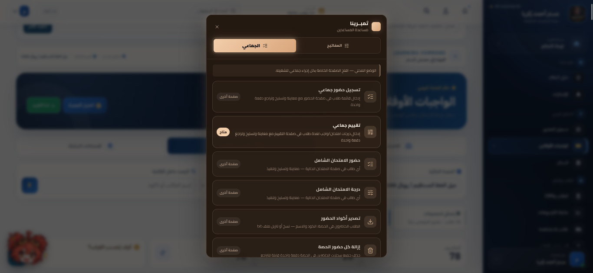
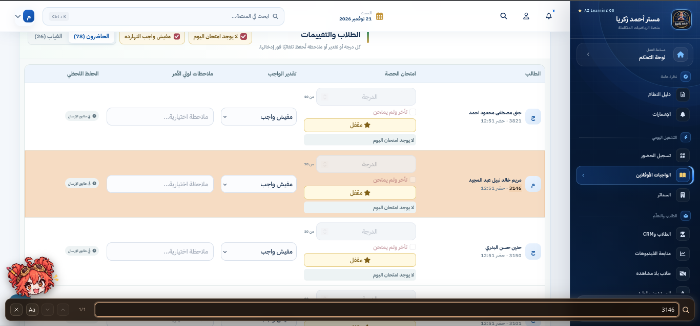

#  User Guide

Tamperina lives on the Ahmed Zakaria platform (`mrahmedzakaria.online`). It adds a small pixel mascot to every page; click it to open a modal with two tabs:

- **المفاتيح** (Toggles) — independent switches and the undo history viewer.
- **الجماعي** (Bulk) — workflow tools, grouped by page and by run kind.

Everything Tamperina does goes through the platform's own forms and requests. It never asks for your password, never sends data to a third-party server, and does not replace the page you are working in.

<br />

<div align="center">
  
</div>

<br />

---

##  Install and update

### Production (auto-updating)

1. Install [Tampermonkey](https://www.tampermonkey.net/) in your browser.
2. Open the raw install URL:
   ```text
   https://raw.githubusercontent.com/Omar-Khaled-57/Tamperina/main/dist/tamperina.user.js
   ```
3. Confirm installation in Tampermonkey. Open the platform — the mascot appears in the bottom-right corner.

Updates are fetched automatically from the same raw URL. The committed `dist/tamperina.user.js` is the install source; CI rebuilds and commits it whenever source changes land on `main`.

### Development build

If you are testing a local build, run `npm run build:dev` and import `dist/tamperina.dev.user.js`. It matches only the live feature pages plus `localhost:8080` and has **no** update URL, so Tampermonkey will not refresh it automatically. The production and DEV builds share one network-observer controller through `unsafeWindow`, so enabling both at once still records each action only once.

>  The DEV build is for contributors. See the [Developer Guide](developer-guide.md#build-the-userscripts) for the full workflow.

---

##  The mascot

| Input | What happens |
|---|---|
| Hover the mascot | A pill appears above it with shrink, grow, mirror, pause, lock and click-through controls. |
| `−` / `+` buttons, or mouse wheel | Resize between **64px and 240px**, snapped to 12px steps. The size is saved. |
| **Mirror** | Flip the sprite horizontally. |
| **Pause** | Stop the idle wobble and reveal three frame buttons: **F1** (+10°), **F2** (−10°), **F3** (upright). |
| **Lock** | Disable dragging. |
| **Click-through** | Let clicks pass through to the page. The mascot becomes a faint ghost and a small pin appears to restore it. |
| Drag | Move the launcher anywhere. Position is saved as a percentage of the viewport. |
| Click / `Enter` / `Space` | Open the options modal. |
| `Alt+Shift+T` | Open the modal, or restore the mascot if click-through is active. |

Pinch/zoom wheel resizing uses whichever scroll axis moved more. `Esc` or a backdrop click closes the modal.

---

##  Keyboard shortcuts

| Shortcut | Where | Result |
|---|---|---|
| `Ctrl+Z` / `⌘+Z` | Any page with history | Undo the last recorded action (or the last bulk batch). |
| `Ctrl+Y`, `Ctrl+Shift+Z`, `⌘+Y`, `⌘+Shift+Z` | Any page with history | Redo the last undone action. |
| `Ctrl+Z` / `Ctrl+Y` in a focused input | `/attendance/scan` only | Still runs Tamperina instead of the browser's text undo. |
| `Ctrl+Alt+F` | `/evaluation` | Toggle the evaluation find bar. Plain `Ctrl+F` stays with the browser. |
| `Alt+Shift+T` | Anywhere | Open settings or restore from click-through. |
| Grade letters | `/evaluation`, with a row selected | Apply a grade — see [Grade hotkeys](#grade-hotkeys). |
| Digits and `.` | `/evaluation`, with a row selected | Type an exam score; `Enter` or a 400ms pause commits. |
| `Backspace` | Same | Delete the last typed score character. |
| `Enter` / `Shift+Enter` | Find bar open | Next / previous match (or hand off on a 4-digit code). |
| `Esc` | Global | Closes the find bar, then the modal, then clears the selected student — in that order. |

>  Undo/redo shortcuts are suppressed while you type in fields on pages other than attendance, so they do not fight normal text editing. Inside Tamperina's own inputs they always work.

---

##  The Toggles tab

Each switch is independent. The table below is the complete set; "default" is the state on a fresh install.

| Toggle | Default | Available | What it does |
|---|---|---|---|
| **التراجع وإعادة التنفيذ** — Undo / Redo | On | Everywhere | Records reversible attendance and grade writes; enables the shortcut and history viewer. Bulk run buttons require it. |
| **مركِز نافذة الدفع** — Center modal | Off | Everywhere | Forces the platform's payment modal/dialog to the center of the viewport. |
| **إخفاء الباركود** — Hide barcode | Off | Everywhere | Hides barcode elements on the host page. |
| **اختيار الطالب والاختصارات** — Student select + hotkeys | On | `/evaluation` | Click a row to select it, then grade with shortcuts. |
| **شريط البحث في التقييم** — Evaluation find bar | On | `/evaluation` | Enables `Ctrl+Alt+F` search and 4-digit auto-select. |
| **لوحة حضور الامتحان القابلة للتعديل** — Editable exam attendance stage | Off | Everywhere (stage shows on exam pages) | Reveals an editable check-in stage table before an exam bulk run. |
| **إيقاف رسائل واتساب حتى الموافقة** — Hold WhatsApp until approved | Off | Everywhere (notice shows on exam pages) | Stops the WhatsApp worker and shows an in-page notice until you allow sending. |
| **الأوامر الجماعية عن بُعد** — Remote bulk actions | Off | Everywhere | Routes the four bulk run actions to another tab instead of the current page. |
| **الوضع الإنجليزي** — English mode | Off (Arabic) | Everywhere | Flips Tamperina's own labels and the layout to LTR. Host-page data stays Arabic. |

The **homework buttons** switch exists in code but is currently hard-disabled — see [Known limitations](troubleshooting.md#known-limitations).

### The undo history viewer

With Undo/Redo enabled, the Toggles tab shows:

- **Undo** and **Redo** buttons, labeled with `Ctrl+Z` and `Ctrl+Y`.
- A history count and the last six actions (title, detail, time).
- A footer note reminding you that history lives in `sessionStorage` until the tab or browser closes.

Undoing a single action is immediate — there is no confirmation dialog, because the action is already reversible and every result is confirmed by a toast. A completed bulk run appears as **one** history entry; undoing it rolls back every successful row.

---

##  Evaluation tools

These tools work on the `/evaluation` page. The two visible switches remember their state when you leave the page but are disabled there.

<div align="center">
  
</div>

### Selecting a student

With **اختيار الطالب والاختصارات** on, click anywhere in a student row to select it. The row is outlined and a toast confirms the selection. Clicking inputs, buttons or links inside the row does not change the selection. You can also select a student by typing an exact four-digit code in the find bar — that works even when this switch is off.

### Grade hotkeys

| Key(s) | Grade |
|---|---|
| `?` / `؟` / `h` / `H` / `ا` | امتياز |
| `ج` / `[` / `{` | جيد جدا |
| `ح` / `p` / `P` | جيد |
| `م` / `l` / `L` | مقبول |
| `ض` / `q` / `Q` | ضعيف |
| `ن` / `k` / `K` | الواجب ناقص |

Aliases cover both Arabic and English keyboard layouts. `Shift` variants of the Latin letters work too. Hotkeys are ignored while you are typing in a field, in the find bar, or inside Tamperina's own UI.

### Typing an exam score

With a row selected:

1. Type digits and optionally a dot — `7.5` works, Arabic-Indic (`٧٫٥`) and Persian digits are normalized.
2. The score appears in the page's exam-score input as you type. `Backspace` removes the last character.
3. Press `Enter` or pause briefly (400ms) to commit. Tamperina dispatches the page's own `change` event, so auto-save and undo/redo both stay in sync.

### The find bar

Press `Ctrl+Alt+F` on `/evaluation` to open a Firefox-style search bar at the bottom of the page. While it is open, toasts and the mascot launcher glide upward so they stay visible above the bar, and settle back down when it closes.

- Type a name or code to search all student rows; matches are highlighted and the bar shows `current/total`.
- `Enter` moves to the next match; `Shift+Enter` to the previous one. The **Aa** button toggles case sensitivity.
- A query of exactly **four digits** auto-selects the matching student. Press `Enter` to hand off: the bar closes, focus returns to the page, and your next keys grade that student. Example: `1214`, `Enter`, `10` sets exam score 10.
- `Esc` closes the bar and clears highlights.

### Homework buttons

The glowing homework-grade button replacement is present in the code but disabled in v0.0.22 so the page's native dropdown stays in charge. The menu's homework diagnostic command still reports what Tamperina detects, and **bulk evaluation** can apply a homework grade from pasted input.

---

##  Bulk actions

Open **الجماعي** to see the available actions. Availability depends on the current page; when remote mode is on, the four *run* actions are available from any page and execute in a target tab instead.

| Action | Page | Undoable? |
|---|---|---|
| **تسجيل حضور جماعي** — Bulk attendance | `/attendance/scan` | Yes (one batch) |
| **تقييم جماعي** — Bulk evaluation | `/evaluation` | Yes (one batch) |
| **حضور الامتحان الشامل** — Exam attendance | `/comprehensive-exams/<id>` | No (check-in has no confirmed delete route) |
| **درجة الامتحان الشامل** — Exam grading | `/comprehensive-exams/<id>` | Yes |
| **تصدير أكواد الحضور** — Export attendance codes | `/attendance/scan` | Read-only |
| **إزالة كل حضور الحصة** — Remove all lesson attendance | `/attendance/scan` | Yes (one batch) |


### The safety path

Every write action follows the same sequence:

1. **Paste / configure** the input and confirm the lesson or exam id.
2. **Preview & analyze** (معاينة وتحليل). Tamperina parses the input and shows what it understood.
3. **Resolve** ambiguous names, not-found codes or ambiguous grades. Nothing is written yet.
4. **Arm** (تسليح التنفيذ). This is the explicit confirmation, and it is disabled until the preview is clean.
5. **Run** (تنفيذ). Requires Undo/Redo to be enabled. Each row is logged as it completes.
6. **Undo** with `Ctrl+Z` rolls back the whole run as one batch where a confirmed undo route exists.

**إيقاف** (Stop) is available while a run is in progress and takes effect between students. Changing any staged field after preview disarms the run again.

---

### تسجيل حضور جماعي — Bulk attendance

On `/attendance/scan` (including `?lesson_id=...` links):

1. Paste one student per line — a **code** or a **name**. Tamperina normalizes Arabic/Persian digits, removes duplicates and ignores invalid tokens.
2. Confirm the lesson id (prefilled from the open page). To use a different lesson, open that lesson's scan page first.
3. Click **معاينة وتحليل**. Codes are accepted directly; names are searched in the lesson's student list. The preview summarizes direct codes, recognized names, rows needing a decision, ignored rows, walk-ins, ready entries, duplicates, mode and invalid tokens, and warns you when the lesson id does not match the open page or Undo/Redo is off.
4. Resolve **not found**, **ambiguous** or **too many matches** rows: choose the right student, edit the name and search again, use **تجاهل (يدويًا)** to skip, or register them as new students (below). When a name is auto-selected, the chosen student is marked **✓ المُختار — سيُسجَّل في الحضور** while other results are dimmed under "نتائج أخرى — غير مختارة".
5. Click **تسليح التنفيذ**, then **تنفيذ**. Ignored names remain listed in **طلاب غير محلولين / مُتجاهَلين**, so you can still copy the whole list after using **تجاهل الكل**.

**Modes.** Tamperina detects the page's mode from the scan form (سنتر / مدرسة) and lets you switch it in the panel:

- **سنتر (center):** drives the page's scan form sequentially, one student at a time.
- **مدرسة (school):** posts directly to `/attendance`, up to five students in parallel, waiting briefly for confirmation after each row.

A failed post or a missing observer event is logged for that student and the run **continues** with the rest of the list. "Already registered" checks are scoped to the selected lesson, so a code reused in another year group is not skipped. The completion toast reports created / already present / skipped / failed counts.

#### School-mode payment input

One student per line. A code or name is enough; payment is optional and is only sent when you write it explicitly:

```text
2017, 45, كامل
2016, 10, مخفض
2015, مخفض, 10
أحمد محمد, 0, نسي
أحمد محمد, مؤجل
2018, 30
2019
أحمد محمد
```

Accepted status words:

| Status | Accepted words |
|---|---|
| Paid | `كامل`, `مدفوع`, `paid`, `full` |
| Partial | `جزئي`, `partial` |
| Discounted / free | `مخفض`, `مجاني`, `مخفض/مجاني`, `discounted`, `free` |
| Forgotten / deferred | `نسي`, `نسي الفلوس`, `مؤجل`, `دفع مؤجل`, `متأخر`, `forgot`, `forgotten`, `deferred` |

Either comma `,` or the Arabic comma `،` works (semicolons too), and amount and status may be swapped. A bare second number means **partial** payment. With no payment field, no payment data is sent at all, so the platform's lesson default applies — Tamperina never silently marks students as fully paid. The inline **الدفع** controls in the preview can override any entry, including resetting it to **افتراضي الحصة**; changing one disarms the run.

Suggested prompt for transcribing handwriting:

```text
استخرج طلاب القائمة المكتوبة يدويًا. اكتب في كل سطر كود الطالب إن كان واضحًا، وإلا اكتب اسم الطالب كما هو. سطر واحد لكل طالب، بدون شرح أو ترقيم.
```

#### Registering unresolved names as new students

The **تسجيل طلاب جدد بدون كارت** button next to **نسخ** / **تجاهل الكل** opens a preview of names with no matching code (for example, a student who forgot their card). Each name shows the amount that will be paid — the amount from the input line, or `45` (the form's own default) — and you can edit it before confirming.

Confirming fills the platform's own `#walkInForm` (using **إضافة اسم آخر** so generated row keys and listeners stay intact) and submits it, creating the student and recording the collection in the school lesson account. Successful rows are marked **تم تسجيله طالبًا جديدًا**, removed from the attendance batch and logged. **These registrations are not undoable.** If the walk-in panel is collapsed on the page, open it first.

#### Diagnosing a run that stops short

Every run produces a **تقرير التشخيص** panel under the execution log. Per student it records the exact request payload, HTTP status and status text, raw response body (including Laravel `errors` fields), whether the observer saw `add` / `duplicate` / timeout, and any exception stack. It also lists input lines that were **never attempted**, which distinguishes a genuine early stop from server rejections.

- **نسخ التقرير** copies the whole report; **نسخ الأكواد الفاشلة** copies just the failed codes for a separate retry run.
- The report is also printed to the browser console (`[Tamperina] bulk attendance diagnostic`) and available from the Tampermonkey command **Tamperina — نسخ تقرير آخر دفعة حضور**.
- Hovering a log row shows its raw diagnostic JSON; failed rows also show `HTTP <status>` inline.

After a failed run, **إعادة المحاولة** reloads the failed codes into the preview → arm → run pipeline. The last report and rows survive reloads in `sessionStorage` under `tamperina.bulk.lastRun.v1` and are validated before use.

---

### تقييم جماعي — Bulk evaluation

On `/evaluation`, paste one student per line in the form:

```text
code, exam score, homework grade
```

For example:

```text
1214, 9, امتياز
3766, 10
أحمد محمد, مقبول
```

Rules:

- The first field identifies a student by **code** or **name**; names are matched against the current page's rows (exact, then partial; 2–12 partial matches are offered as choices, more are rejected as too many). `#` starts a comment and blank lines are skipped.
- One number sets the **exam score**; one grade text sets the **homework** grade. Number and grade text may appear in either order. Arabic status/grade text stays as on the site.
- Two numbers are **ambiguous** — the panel asks you to map them to exam and homework before you can arm.
- Unknown values, too many fields and identifier-less lines are reported as invalid.
- Applying grades uses the page's own inputs and dispatches `input` + `change`, so auto-save and undo/redo keep working. The whole run is one undoable batch.

The log marks each row as applied, partial, not found, missing field, invalid, error, stopped or skipped, and **نسخ النتائج** copies a summary.

---

### تصدير أكواد الحضور — Export attendance codes

Reads the lesson's attendance records cached by the undo observer and lists them as:

```text
CODE, Name
```

Codes are uppercased and deduplicated, names come from the cached record, and lines are sorted in Arabic collation order. Use **نسخ** for the clipboard or **تنزيل** to save a UTF-8 `.txt` with BOM named `attendance-ids-<lesson>-<YYYY-MM-DD>.txt`. If no lesson is selected, all cached records are exported.

---

### إزالة كل حضور الحصة — Remove all lesson attendance

On `/attendance/scan`:

1. Confirm the lesson id and press **تحديث** — Tamperina refreshes the live attendance list for that lesson.
2. Preview shows up to 20 records (with a count for the rest).
3. **تسليح التنفيذ** → **تنفيذ**. Requires Undo/Redo.
4. Each deletion is logged; the whole run is one batch, so `Ctrl+Z` restores every record. **إيقاف** stops between records.

---

##  Exam and remote tools

<div align="center">
</div>

### Editable exam attendance stage

Turn on **لوحة حضور الامتحان القابلة للتعديل**, then open a `/comprehensive-exams/<id>` page and start **حضور الامتحان الشامل**. Before preview you get an editable stage table where you can:

- add or remove rows for any student code (Arabic/Persian digits are normalized);
- include or exclude a row from the run;
- set payment status (`paid`, `exempt`, `deferred`), amount, payment note, and check-in source (`manual`, `scanner`, `camera`, `image`).

Any edit disarms the run. After preview, the same editable fields appear inline on the review rows. Confirm still submits through the platform's own `#examScan` form — there is no separate bulk endpoint. **Exam check-ins are not undoable** because there is no confirmed delete route.

### Holding WhatsApp messages

Turn on **إيقاف رسائل واتساب حتى الموافقة** to stop the platform's WhatsApp worker and show an in-page notice in the exam work area. The notice has an **allow sending** button that resumes it. Tamperina only auto-resumes a worker it stopped itself; if someone else stopped it, Tamperina leaves it alone. A GM marker (`tamperina.whatsapp.heldByTamperina.v1`) remembers ownership across reloads.

### Remote bulk actions

Turn on **الأوامر الجماعية عن بُعد** to make the four run actions launch in *another tab* instead of the current page. This is a mode toggle, not a separate bulk menu item.

1. Open the target page in another tab (e.g. `/attendance/scan?lesson_id=...` or `/comprehensive-exams/16`) with Tamperina active.
2. In the source tab, open the wanted bulk action. The remote panel lists compatible target tabs, matched by page and by lesson/exam id.
3. Enter the target id and the input text, then **prepare** → **arm** → **run**. Optionally use **stop**.

The target tab runs the same preview → arm → run pipeline and keeps its own undo history. Input text and phase commands are the only things sent; no credentials or host-page data cross tabs. Tabs advertise themselves every 5 seconds, expire after 15 seconds without a heartbeat, and a request that gets no response times out after 60 seconds. If a run request times out, keep the source tab open and use **stop** — the target may still be executing.

---

##  Language, toasts and menu

### English mode

The **الوضع الإنجليزي** switch flips Tamperina-owned labels — including browser menu commands — to English and switches the shadow layout to LTR. The setting is persisted. Host-page data (grade keys, status words, hotkey characters, selectors, examples) deliberately stays Arabic in both modes so the script keeps matching the real site.

### Toasts

Every result produces a toast with a Tamperina sticker. Variants are `applied` (default), `undo`, `redo`, `error`, `warning` and `info`; they reuse the available art (`applied`, `note`, `thumb`, `err` and `limited`) rather than requiring a separate sticker for every state. At most three are shown at once; some include an action button (for example a retry). The close button is translated with the rest of the UI.

### Tampermonkey menu commands

| Command | Action |
|---|---|
| Tamperina — Open settings | Opens the modal. |
| Tamperina — Undo / Redo / Toggle undo | Same actions as the panel; shortcuts work anywhere with history. |
| Tamperina — Undo diagnostic | Prints recent observed write requests and skip reasons to the console. |
| Tamperina — Evaluation find | Toggles the find bar on `/evaluation`. |
| Tamperina — Copy last attendance batch report | Copies the last bulk diagnostic report. |
| Tamperina — Diagnose homework buttons | Copies a report of detected selects and grade options. |
| Tamperina — Toast preview | Shows a sample notification toast. |
| Tamperina — Cancel click-through | Restores the mascot if it is letting clicks pass through. |

Commands are re-registered when the language changes so their captions follow the selected locale.

---

## Where to go next

- Need an exact default, key, format, or selector? → [Feature Reference](feature-reference.md)
- Want to know *how* it works? → [Architecture](architecture.md)
- Something did not record, apply, or respond? → [Troubleshooting](troubleshooting.md)
